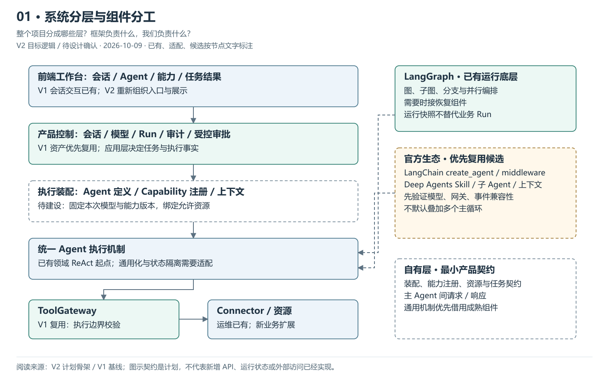
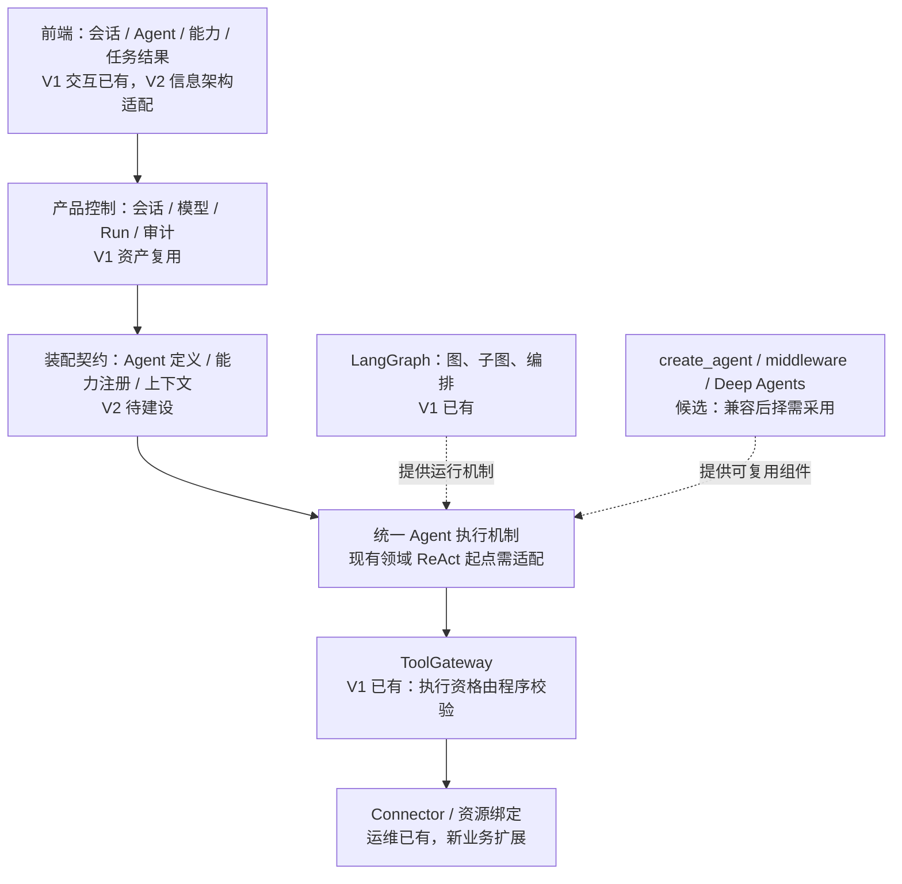

# 01 · 系统分层与组件分工

> 更新：2026-10-09 · V2 目标逻辑，待 PRD / Design 确认。
> 本图回答：整个项目分成哪些层？框架负责什么，我们负责什么？
> [图解目录](README.md) · [图解目录](README.md) · [下一图](02-Agent组合与平行维度.md)

[打开可缩放 SVG](01-系统分层与组件分工.svg)。图中状态按节点文字读取，已有资产不等于 V2 装配已完成。

## 读图要点

- 前端、产品控制、执行装配、图运行与资源访问各有职责，业务模块通过能力注册进入执行链。
- LangGraph 是 V1 已有起点；create_agent、官方 middleware 与 Deep Agents 都是尚待兼容验证的组件候选。
- 自有层维护产品契约并复用 V1 会话、模型、Run、ToolGateway 等资产；不是再写一个完整框架。

图中的装配与通用执行是目标职责，并未完成 V2 实施。Run / 审批 / 权限的业务事实不会因采用框架而改由图状态或 checkpoint 决定。

## 可编辑的结构源图

Mermaid 与 SVG 展示同一组职责；SVG 简化部分返回线以保持可读性，以明确的边界说明为准。修改结构时需同步源图、SVG 与 PNG 预览。

依据：[V2 计划骨架](../计划骨架.md)、[V1 基线](../../../../归档/V1-项目与开发进度.md)。
