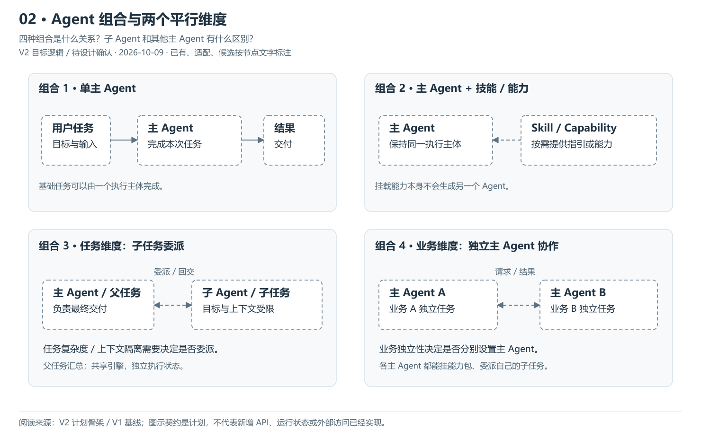
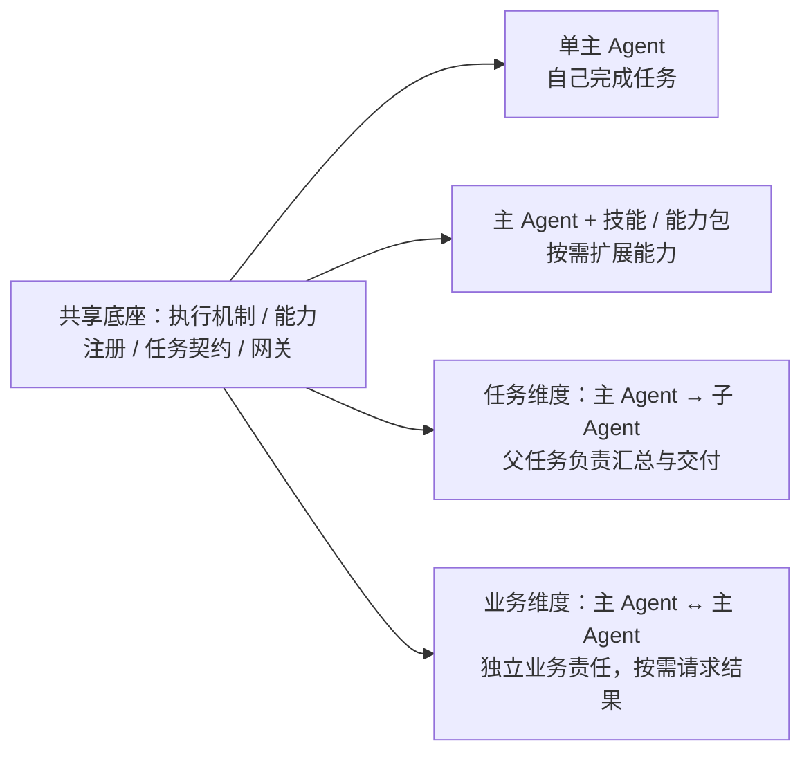

# 02 · Agent 组合与两个平行维度

> 更新：2026-10-09 · V2 目标逻辑，待 PRD / Design 确认。
> 本图回答：四种组合是什么关系？子 Agent 和其他主 Agent 有什么区别？
> [上一图](01-系统分层与组件分工.md) · [图解目录](README.md) · [下一图](03-单次任务与主Agent循环.md)

[打开可缩放 SVG](02-Agent组合与平行维度.svg)。图中状态按节点文字读取，已有资产不等于 V2 装配已完成。

## 读图要点

- 四种组合共用底座，既不是四套运行时，也不是从低到高的升级路线。
- 基础主 Agent 可以按需挂技能 / 能力；任务复杂度与隔离需求决定是否委派子任务。
- 业务独立性决定是否由多个主 Agent 协作；一个业务主 Agent 也可以挂能力、派子 Agent。

四种组合是目标使用方式。V1 有领域角色与诊断编排资产，不能直接视为这些通用装配和协作机制已经实现。

## 可编辑的结构源图

Mermaid 与 SVG 展示同一组职责；SVG 简化部分返回线以保持可读性，以明确的边界说明为准。修改结构时需同步源图、SVG 与 PNG 预览。

依据：[V2 计划骨架](../计划骨架.md)、[V1 基线](../../../../归档/V1-项目与开发进度.md)。
