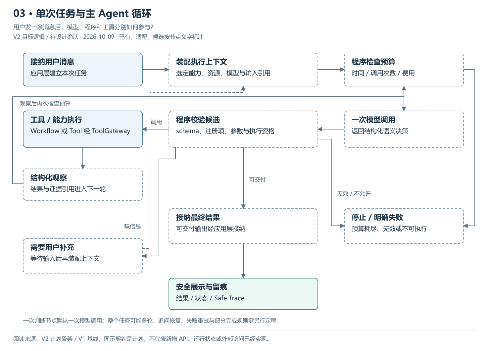
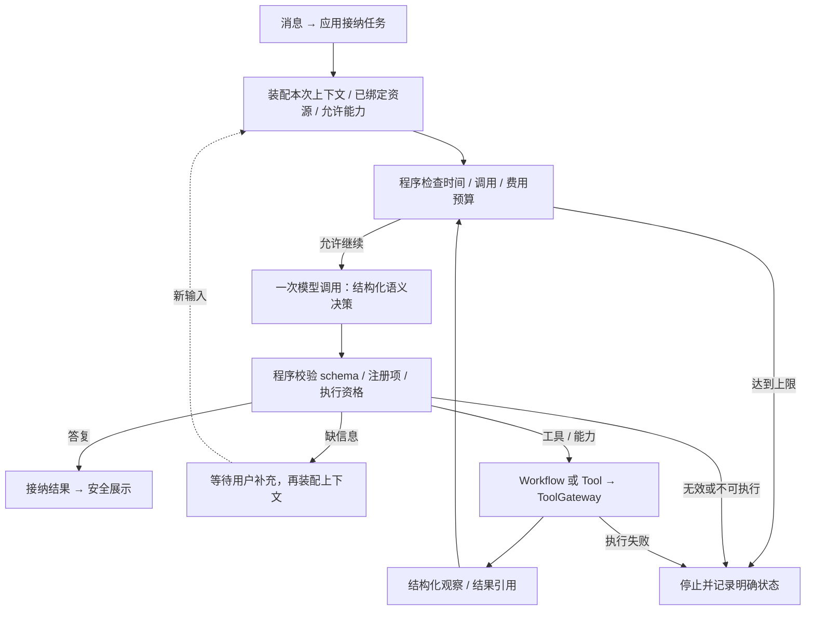

# 03 · 单次任务与主 Agent 循环

> 更新：2026-10-09 · V2 目标逻辑，待 PRD / Design 确认。
> 本图回答：用户发一条消息后，模型、程序和工具分别如何参与？
> [上一图](02-Agent组合与平行维度.md) · [图解目录](README.md) · [下一图](04-Capability与业务工作流.md)

[打开可缩放 SVG](03-单次任务与主Agent循环.svg)。图中状态按节点文字读取，已有资产不等于 V2 装配已完成。

## 读图要点

- 先接纳任务并装配允许能力、资源与本次上下文，再调用模型作语义决策。
- 一次语义决策节点默认一次模型调用；工具结果可能触发下一轮，所以不是整项任务只调用模型一次。
- 模型给出结构化候选，程序校验再执行。工具观察、最终答复、追问和失败有不同处理路径。

失败处理这里做了简化，具体可重试错误、部分完成及追问恢复策略还需 Design。子任务和跨业务调用接入同一候选校验过程，详见图 05 / 06；正则不用于代替生产语义路由。

## 可编辑的结构源图

Mermaid 与 SVG 展示同一组职责；SVG 简化部分返回线以保持可读性，以明确的边界说明为准。修改结构时需同步源图、SVG 与 PNG 预览。

依据：[V2 计划骨架](../计划骨架.md)、[V1 基线](../../../../归档/V1-项目与开发进度.md)。
