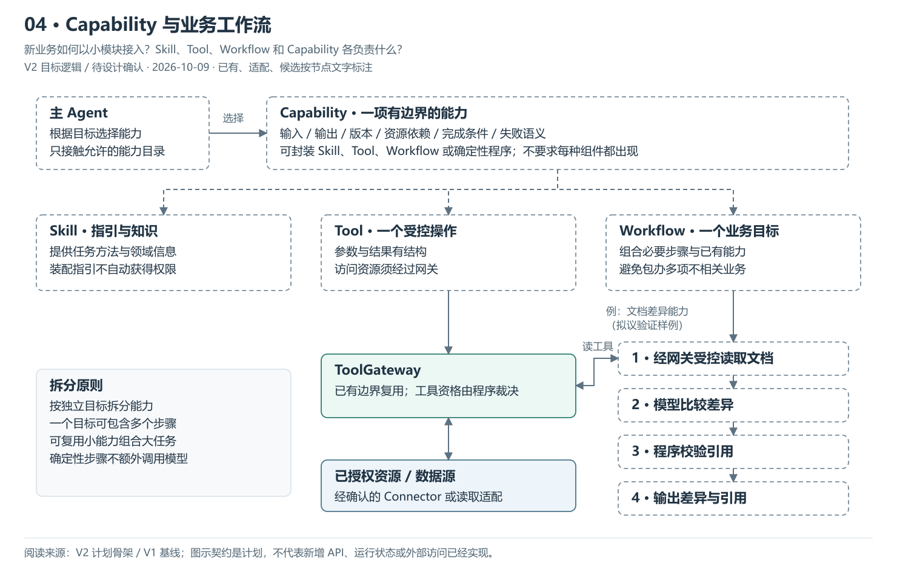
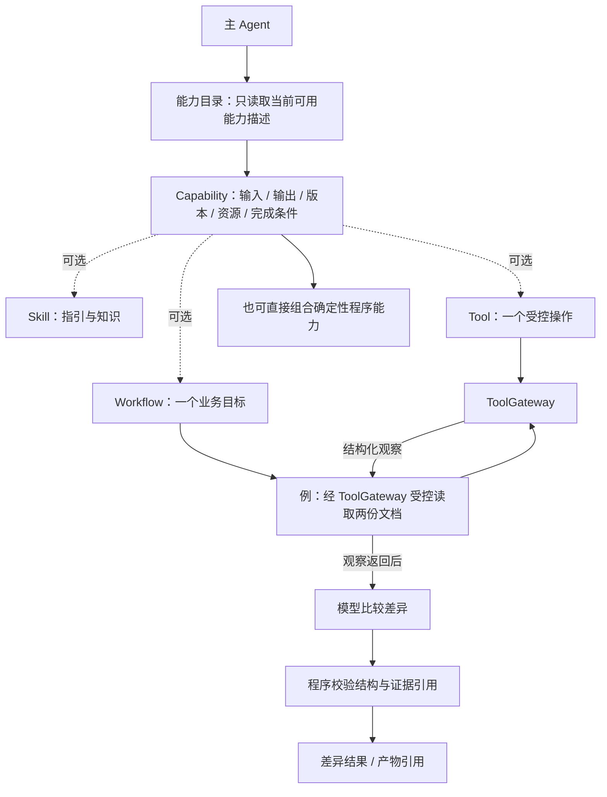

# 04 · Capability 与业务工作流

> 更新：2026-10-09 · V2 目标逻辑，待 PRD / Design 确认。
> 本图回答：新业务如何以小模块接入？Skill、Tool、Workflow 和 Capability 各负责什么？
> [上一图](03-单次任务与主Agent循环.md) · [图解目录](README.md) · [下一图](05-子Agent委派与上下文隔离.md)

[打开可缩放 SVG](04-Capability与业务工作流.svg)。图中状态按节点文字读取，已有资产不等于 V2 装配已完成。

## 读图要点

- Capability 是有边界的对外能力，声明输入输出、版本、资源依赖与完成条件；并不是所有组件都必须一起出现。
- Skill 提供指引；Tool 提供具体受控操作；Workflow 围绕一个独立业务目标组织必要步骤。
- 复杂业务通过复用小能力组合，不要求每个小步骤都拆为独立工作流，也不要求每个步骤调用模型。

文档差异仅为拟议验证样例，不代表选定商业业务、已有文档上传能力或开放文件访问。Workflow 需要工具时仍经网关；资源访问须有已确认的适配与范围。

## 可编辑的结构源图

Mermaid 与 SVG 展示同一组职责；SVG 简化部分返回线以保持可读性，以明确的边界说明为准。修改结构时需同步源图、SVG 与 PNG 预览。

依据：[V2 计划骨架](../计划骨架.md)、[V1 基线](../../../../归档/V1-项目与开发进度.md)。
