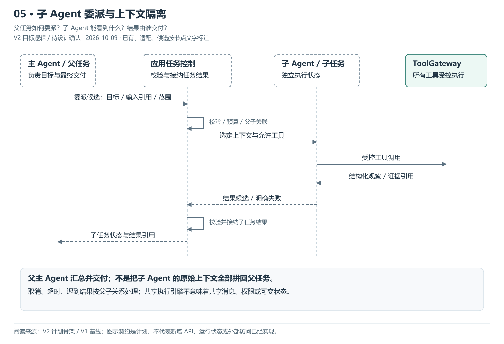
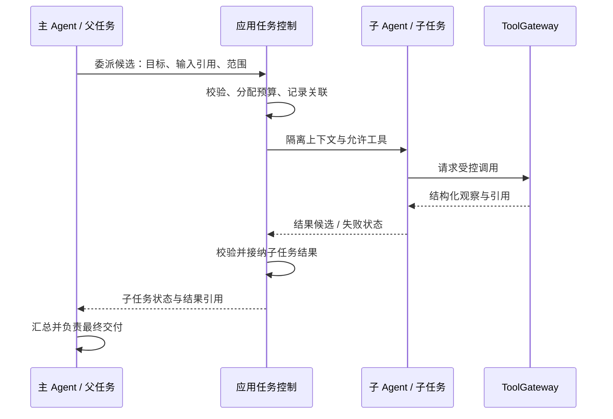

# 05 · 子 Agent 委派与上下文隔离

> 更新：2026-10-09 · V2 目标逻辑，待 PRD / Design 确认。
> 本图回答：父任务如何委派？子 Agent 能看到什么？结果由谁交付？
> [上一图](04-Capability与业务工作流.md) · [图解目录](README.md) · [下一图](06-独立主Agent协作与交付.md)

[打开可缩放 SVG](05-子Agent委派与上下文隔离.svg)。图中状态按节点文字读取，已有资产不等于 V2 装配已完成。

## 读图要点

- 父主 Agent 提出目标、输入引用与允许范围，应用层校验并建立父子任务关联。
- 子任务使用独立运行状态，只接收被选中的上下文；复用执行引擎不意味着共享可变消息历史。
- 子 Agent 返回结构化结果与引用，父主 Agent 汇总交付；取消、超时和失败按父子关系处理。

首版可使用 LangGraph 子图输入输出映射实现任务上下文隔离。父取消后的停止与迟到结果处理需明确；上下文隔离不等于已经拥有独立权限或进程沙箱。

## 可编辑的结构源图

Mermaid 与 SVG 展示同一组职责；SVG 简化部分返回线以保持可读性，以明确的边界说明为准。修改结构时需同步源图、SVG 与 PNG 预览。

依据：[V2 计划骨架](../计划骨架.md)、[V1 基线](../../../../归档/V1-项目与开发进度.md)。
