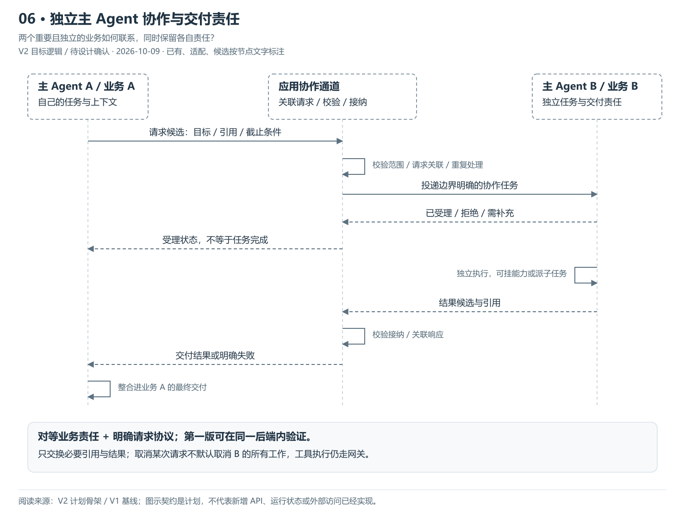
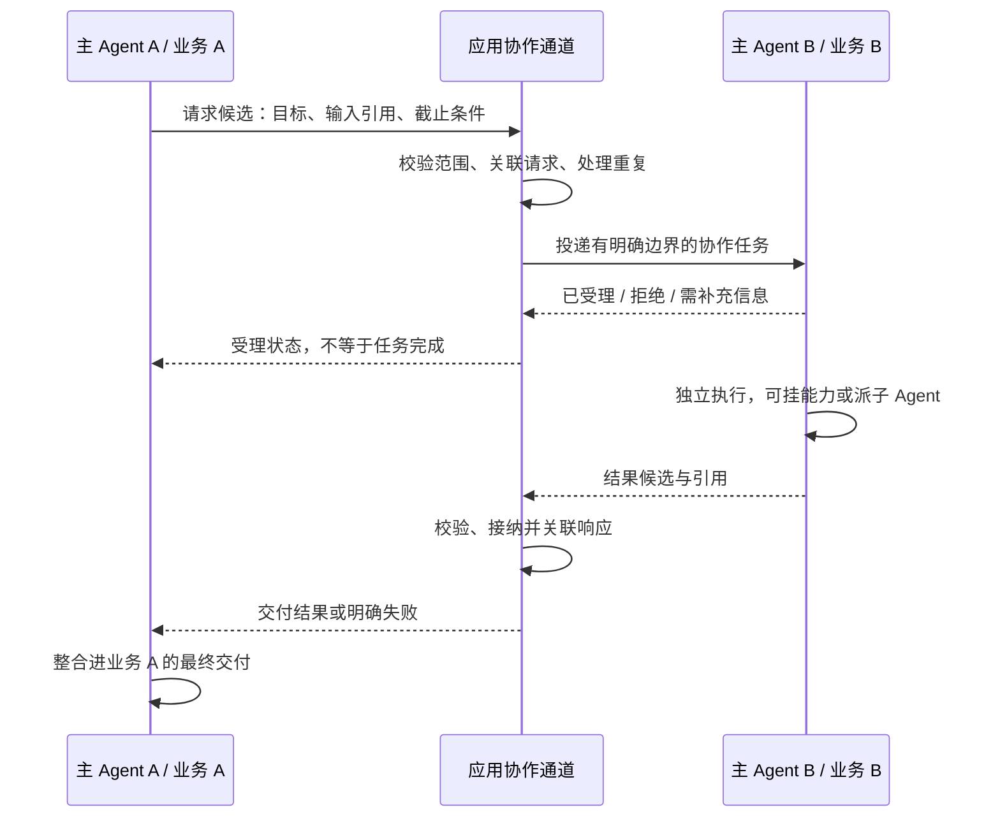

# 06 · 独立主 Agent 协作与交付责任

> 更新：2026-10-09 · V2 目标逻辑，待 PRD / Design 确认。
> 本图回答：两个重要且独立的业务如何联系，同时保留各自责任？
> [上一图](05-子Agent委派与上下文隔离.md) · [图解目录](README.md) · [下一图](07-上下文任务与结果契约.md)

[打开可缩放 SVG](06-独立主Agent协作与交付.svg)。图中状态按节点文字读取，已有资产不等于 V2 装配已完成。

## 读图要点

- 主 Agent A 与 B 各自拥有业务任务和上下文，双方不是长期主管 / 下属关系。
- 通过有标识的请求、响应、输入与结果引用协作；受理请求和完成结果是两个不同事件。
- 发起方负责自己的最终交付；接收方负责承接任务。取消请求不能默认取消对方所有独立工作。

第一版建议在同一后端内验证，不预设外部 A2A 协议或消息中间件。跨业务超时、权限、循环请求上限、结果版本和取消范围待 Design；不会默认交换完整会话或记忆。

## 可编辑的结构源图

Mermaid 与 SVG 展示同一组职责；SVG 简化部分返回线以保持可读性，以明确的边界说明为准。修改结构时需同步源图、SVG 与 PNG 预览。

依据：[V2 计划骨架](../计划骨架.md)、[V1 基线](../../../../归档/V1-项目与开发进度.md)。
