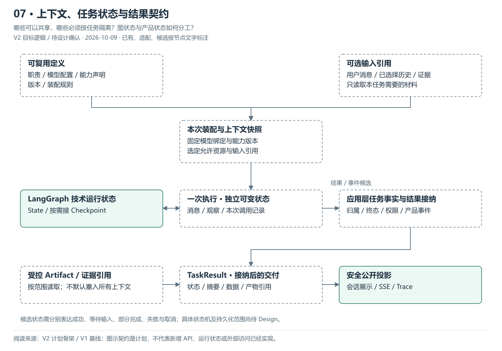
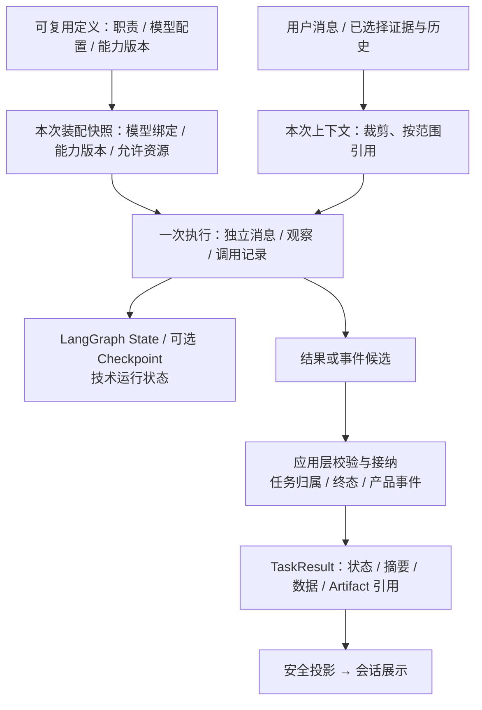

# 07 · 上下文、任务状态与结果契约

> 更新：2026-10-09 · V2 目标逻辑，待 PRD / Design 确认。
> 本图回答：哪些可以共享，哪些必须按任务隔离？图状态与产品状态如何分工？
> [上一图](06-独立主Agent协作与交付.md) · [图解目录](README.md) · [下一图](08-现状复用与建设顺序.md)

[打开可缩放 SVG](07-上下文任务与结果契约.svg)。图中状态按节点文字读取，已有资产不等于 V2 装配已完成。

## 读图要点

- Agent 定义、能力声明和已编译执行结构可以在满足隔离条件后复用；消息、观察与本次调用记录按执行管理。
- 本次装配固定模型与能力版本，以及选定输入引用。任务需要什么才加载什么，大结果使用受控产物引用。
- LangGraph state / checkpoint 管理运行过程；应用层负责任务归属、结果接纳和产品事件，不能互相替代。

这些是拟议职责和契约，不是已存在的 API / 数据库字段。当前 Agent 实例持有可变历史；缓存复用图之前必须先消除状态串线。原始大结果的存储、保留和读取范围需独立确定。

## 可编辑的结构源图

Mermaid 与 SVG 展示同一组职责；SVG 简化部分返回线以保持可读性，以明确的边界说明为准。修改结构时需同步源图、SVG 与 PNG 预览。

依据：[V2 计划骨架](../计划骨架.md)、[V1 基线](../../../../归档/V1-项目与开发进度.md)。
