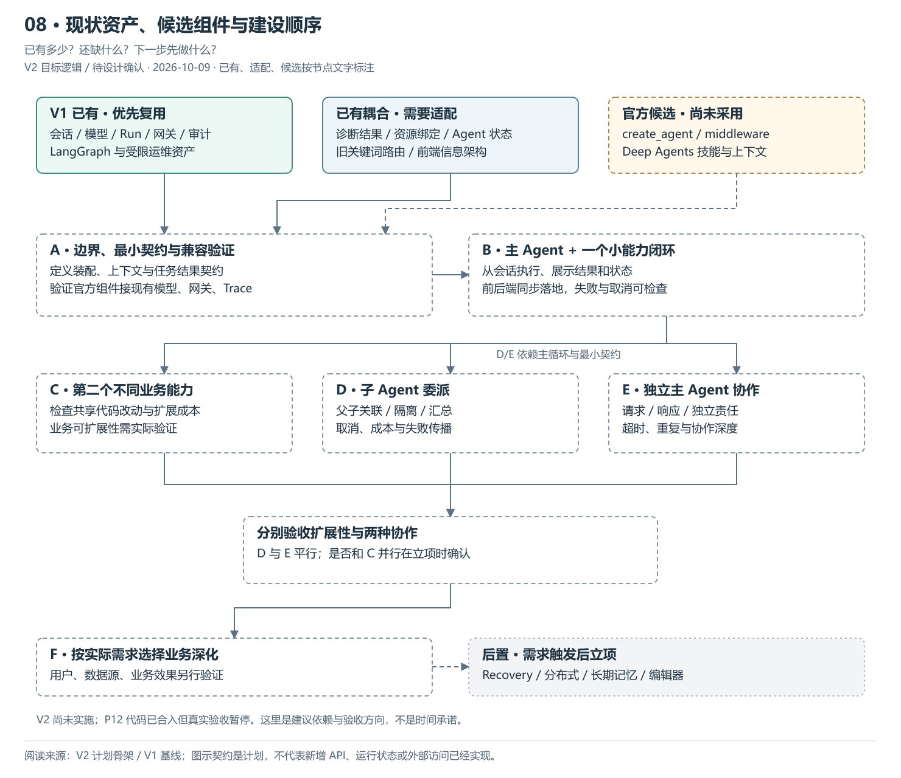
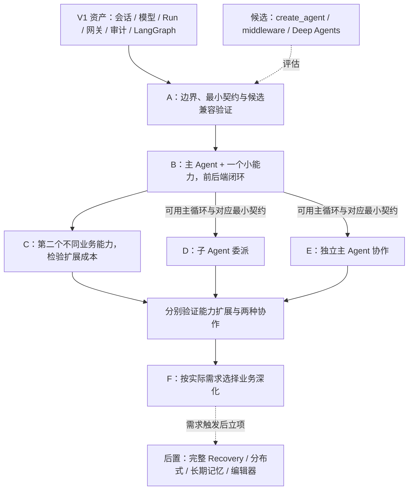

# 08 · 现状资产、候选组件与建设顺序

> 更新：2026-10-09 · V2 目标逻辑，待 PRD / Design 确认。
> 本图回答：已有多少？还缺什么？下一步先做什么？
> [上一图](07-上下文任务与结果契约.md) · [图解目录](README.md) · [回到计划骨架](../计划骨架.md)

[打开可缩放 SVG](08-现状复用与建设顺序.svg)。图中状态按节点文字读取，已有资产不等于 V2 装配已完成。

## 读图要点

- V1 已有会话、模型、Run/SSE、网关、安全 Trace、审计及运维资产；P12 代码合入，但真实验收仍暂停。
- V2 尚未实施。通用化需要处理诊断结果、资源绑定、可变 Agent 状态与旧路由；官方组件只是候选。
- 先 A 收敛契约并验证候选兼容，再 B 跑最小闭环；C 检验扩展性，D / E 是平行协作建设。

箭头表示建议依赖，不是时间承诺或已批准 Workpack。D / E 依赖可用主循环与各自需要的最小任务契约，不要求先完成整个 B 的前端闭环；二者不互相依赖，是否与 C 并行需按接口和写入范围判断。

## 可编辑的结构源图

Mermaid 与 SVG 展示同一组职责；SVG 简化部分返回线以保持可读性，以明确的边界说明为准。修改结构时需同步源图、SVG 与 PNG 预览。

依据：[V2 计划骨架](../计划骨架.md)、[V1 基线](../../../../归档/V1-项目与开发进度.md)。
